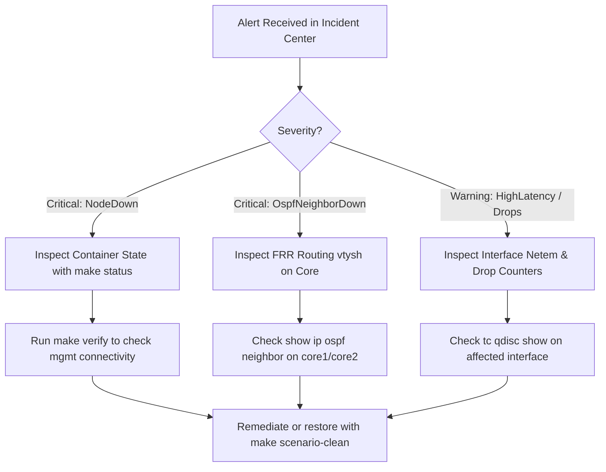

# Chaos Engineering & NOC Operations Manual

## 1. Overview
The NOC-Sim environment provides built-in tools for testing network resilience, chaos engineering, and incident response procedures. Impairments can be triggered manually via CLI scripts or scheduled autonomously to test operations in real time.

---

## 2. The `fault.sh` Low-Level Fault Injector
The script `scripts/fault.sh` operates directly on the Linux network namespace of any container node using `nsenter` and `ip`/`tc` (Traffic Control `netem`).

### Syntax
```bash
scripts/fault.sh <COMMAND> <NODE> [INTERFACE] [VALUE]
```

### Supported Commands

| Command | Arguments | Example | Description |
|---|---|---|---|
| `down` | `NODE IFACE` | `scripts/fault.sh down core1 eth1` | Administratively takes down an interface (`ip link set dev down`). |
| `up` | `NODE IFACE` | `scripts/fault.sh up core1 eth1` | Restores an interface to UP state. |
| `delay` | `NODE IFACE MS` | `scripts/fault.sh delay core1 eth2 80` | Adds transmission latency (RTT increase) via `tc netem delay`. |
| `loss` | `NODE IFACE PCT` | `scripts/fault.sh loss core1 eth2 20` | Injects packet loss percentage via `tc netem loss`. |
| `clear` | `NODE IFACE` | `scripts/fault.sh clear core1 eth2` | Removes all `netem` qdisc latency and loss rules. |
| `isolate`| `NODE` | `scripts/fault.sh isolate core1` | Disables ALL interfaces on the node, simulating total device death. |
| `restore`| `NODE` | `scripts/fault.sh restore core1` | Brings all interfaces back up on the node. |

---

## 3. Pre-Packaged Incident Scenarios (`scenario.sh`)
Standardized real-world incident simulations can be triggered using `scripts/scenario.sh` or through Makefile shortcuts:

### 3.1 Scenario: Core Link Flapping (`make scenario-flap`)
* **Underlying Command**: `./scripts/scenario.sh link-flap 3 5`
* **What happens**: Takes `core1:eth1` down for 5s, restores it, and repeats 3 times.
* **Observable Symptoms**:
  * OSPF dead-timer expires and neighbor state changes to DOWN, then re-establishes through Init $\rightarrow$ Loading $\rightarrow$ Full.
  * `OspfNeighborDown` alert fires in Alertmanager and Incident Center.
  * Syslog streams show repeated `%OSPF-5-ADJCHANGE` messages.

### 3.2 Scenario: Degraded Transit Link (`make scenario-loss`)
* **Underlying Command**: `./scripts/scenario.sh degraded-link 20 60`
* **What happens**: Adds 20% packet loss and 60ms delay to `core1:eth2` (transit link to `dist1`).
* **Observable Symptoms**:
  * Grafana RTT panel spikes above 60 ms.
  * `HighLatency` warning alert triggers.
  * Throughput dips and packet drop counters increment (`network_receive_drop_total`).

### 3.3 Scenario: Catastrophic Core Router Outage (`make scenario-isolate`)
* **Underlying Command**: `./scripts/scenario.sh core-failure`
* **What happens**: Completely isolates `core1` by disabling all network interfaces.
* **Observable Symptoms**:
  * `NodeDown` and `OspfNeighborDown` critical alerts trigger immediately.
  * OSPF topology reconverges to route 100% of traffic via `core2`.
  * Automatic verification verifies `host1 <-> host2` connectivity is maintained via `core2` without loss of end-to-end service.

### 3.4 Scenario: Full Restoration (`make scenario-clean`)
* **Underlying Command**: `./scripts/scenario.sh clean`
* **What happens**: Clears all `tc netem` rules across all nodes and ensures every interface is administratively UP. Runs `verify.sh` to confirm full convergence.

---

## 4. Autonomous Chaos & Incident Scheduler
For continuous background testing without manual intervention:
```bash
make chaos
# or via unified runner:
make simulate-chaos
```
* **Engine**: [scripts/chaos_scheduler.py](file:///home/drac/noc-sim/scripts/chaos_scheduler.py)
* **Behavior**:
  * Waits a random interval (default: 40–90 seconds) between incidents.
  * Randomly selects an incident (buffer bloat, dirty fiber optic loss, link flap storm, or asymmetric degradation).
  * Logs incident trigger time and applies impairment for a 20–50 second duration.
  * Automatically remediates and logs recovery timestamp.

---

## 5. Incident Management Runbook

When an alert triggers in the **Incident Center** (http://127.0.0.1:9095) or **Grafana**:



### Useful CLI Triage Commands
```bash
# Check OSPF neighbor status on core1:
docker exec -it clab-noc-lab-core1 vtysh -c "show ip ospf neighbor"

# Check IP routing table on dist1:
docker exec -it clab-noc-lab-dist1 vtysh -c "show ip route"

# Test latency & MTU from host1:
docker exec -it clab-noc-lab-host1 ping -c 5 192.168.20.10

# Inspect active Linux netem traffic control rules:
sudo nsenter -t $(docker inspect -f '{{.State.Pid}}' clab-noc-lab-core1) -n tc qdisc show dev eth2
```

